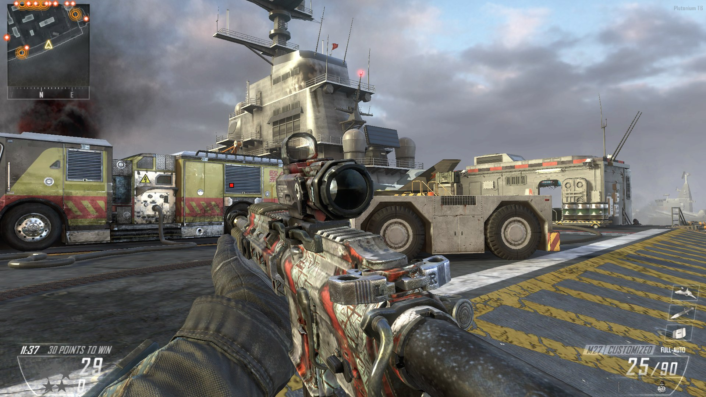
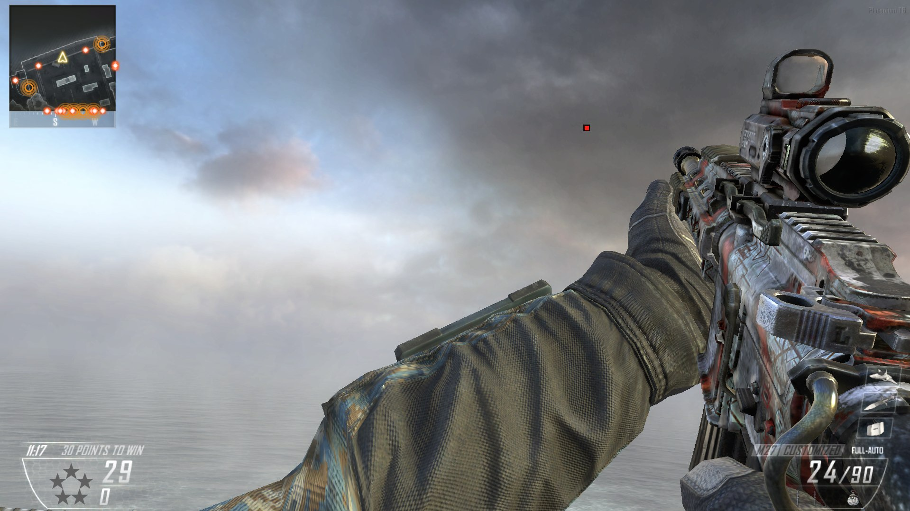
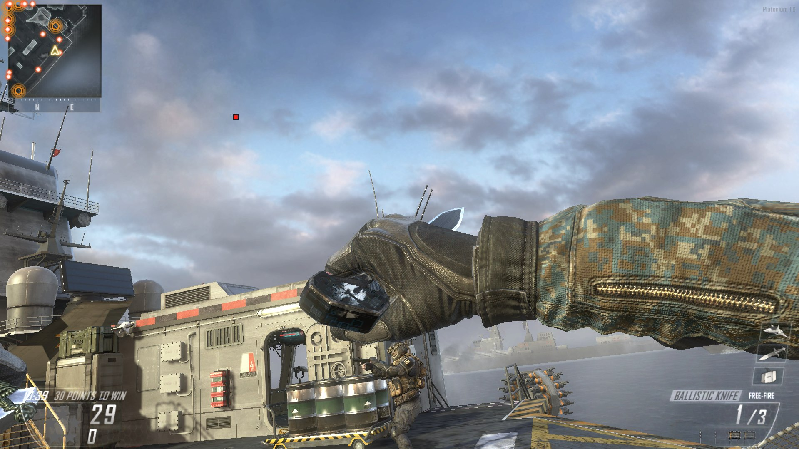

# BO2 Wii U Aim

Plutonium plugin that brings the Black Ops II Wii U aiming to PC multiplayer.

- Hip fire aims like normal PC; the crosshair and gun swing into turns.
- Aiming down sights uses the Wii U pointer.
- Wii U red dot reticle, rocket launcher ring, and floating sniper scope.

## Install

### LAN mode only
Copy [wiiuaim.dll](https://github.com/xS2RT/bo2-wiiu-aim/releases) to `%LOCALAPPDATA%\Plutonium\plugins`.

Settings: `%LOCALAPPDATA%\Plutonium\wiiuaim\wiiuaim.ini`

Multiplayer only.

## Screenshots

